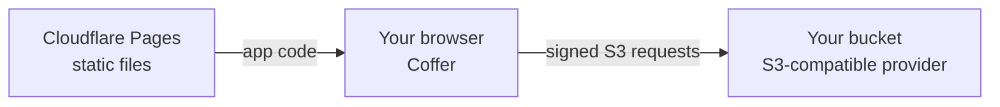

# Coffer

Coffer is a file manager for S3-compatible object storage that runs entirely in your browser. It is built for people who know Google Drive: a file list, search, a context menu, Trash with Undo, previews and share links, on a phone or a desktop. Your access keys never leave the browser.

## Status

**Pre-alpha, specification phase. Nothing is usable yet.** The repository holds the design package, the product and technical specifications and a plan for the first milestones. The application code has not been written. Progress is tracked in the [implementation plan](docs/implementation-plan.md).

Everything below describes what Coffer is planned to do, not what it does today.

## How it works

Coffer is a static site hosted on Cloudflare Pages. It talks directly to the S3 API of your bucket, signing each request in the browser with the keys you enter. There is no backend, no database and no accounts.

The consequence is that your bucket must allow requests from the app's origin (CORS). Coffer shows the exact rule to add when a connection is blocked.

## Planned features

**MVP** (see the [product spec](docs/product-spec.md#release-plan)):

- Connect with 21 provider presets (one of them a generic option with your own endpoint), with a connection test that explains what failed
- Browse folders in list or grid view, with sorting and a name filter for the current folder
- Upload files and folders, with multipart uploads and a transfer panel
- Download, and preview images, video, audio, PDF, text and code, SVG, Markdown and HTML (as source, with an optional sandbox)
- Rename, move, copy and delete, with Trash and Undo
- Share links (presigned URLs with an explicit expiry)
- Save a connection on the device, encrypted with a passphrase, with auto-lock
- Read-only connections for keys that cannot write

**v1:** Starred and Recent, storage usage, command palette and keyboard shortcuts, folder download as .zip, resume of interrupted uploads, drag-to-move, coach tips, changing the passphrase, search across the whole bucket and a demo workspace.

**Not planned:** a backend, a database, accounts, server-side search, a sync client, or bucket administration such as policies and lifecycle rules.

## Supported providers

The presets come from [`design/providers.json`](design/providers.json). A preset only fills in the fields and endpoint; it does not mean the provider has been tested yet. Test results will go in a compatibility matrix before release.

| Provider | Notes |
|---|---|
| Cloudflare R2 |  |
| Backblaze B2 |  |
| Wasabi |  |
| Amazon S3 |  |
| DigitalOcean Spaces |  |
| MinIO | You enter the endpoint yourself |
| Akamai (Linode) |  |
| Alibaba OSS | Virtual-hosted only |
| Google Cloud Storage |  |
| Hetzner |  |
| Huawei OBS |  |
| IBM Cloud Object Storage |  |
| IDrive e2 | Endpoint unique per account; You enter the endpoint yourself |
| Oracle OCI | Browser access not supported (CORS) |
| Other S3-compatible | You enter the endpoint yourself |
| Scaleway |  |
| Storj |  |
| Supabase Storage | Session token supported |
| Tencent COS | Bucket names end with your APPID |
| Tigris |  |
| Vultr |  |

## What your bucket needs

- **A CORS rule** that allows the app's origin. Coffer generates the rule in JSON and XML. Do not use `*` as the allowed origin.
- **An access key limited to one bucket** is recommended. A key that can see many buckets can do more damage if it leaks.

## Security model in brief

This is the design, described in [`design/SECURITY-DESIGN.md`](design/SECURITY-DESIGN.md) and the [technical spec](docs/technical-spec.md#11-security). None of it is implemented yet and no security audit has been run.

- **Stored on your device (if you choose to save a connection):** access keys and session tokens, encrypted with AES-GCM under a key derived from your passphrase with PBKDF2 (at least 600,000 iterations). The passphrase is never stored and cannot be recovered. The operation journal, upload state, starred items and recent files hold key names only and are not encrypted. Settings are in `localStorage`.
- **Without saving,** keys stay in memory and disappear when you close the tab.
- **Coffer never** sends your keys anywhere except as signed requests to your own provider endpoint, loads third-party scripts, fonts or analytics, or renders file names or contents from your bucket as HTML.
- **Limits:** Coffer does not protect against malware or browser extensions on your device, a compromised provider, or someone who learns your passphrase. Share links cannot be revoked before they expire; rotating the access key invalidates all of them.

## Browser support

Current and previous major versions of Chrome, Edge and Firefox. Safari 16.4 or later is required on iOS and desktop.

## Development

Prerequisites: Node 22 (`>=22 <23`; run `nvm use` or `fnm use` to read `.nvmrc`; pnpm refuses other Node versions), pnpm 12 (enable it with `corepack enable`) and Docker (for a local MinIO). `pnpm install` also installs the Git hooks. The commands below exist as of M0, the first milestone of the [implementation plan](docs/implementation-plan.md). The CI workflow in `.github/workflows/ci.yml` runs them on every push and pull request. There is still no usable application: the app is a placeholder page until M1.

| Task | Command |
|---|---|
| Install | `pnpm install --frozen-lockfile` |
| Dev server | `pnpm dev` |
| Build | `pnpm build` |
| Typecheck, lint | `pnpm typecheck`, `pnpm lint` |
| Unit tests | `pnpm test` |
| Generate token CSS from `design/tokens.json` | `pnpm tokens:build` |
| Check generated CSS is current | `pnpm tokens:check` |
| Integration tests (local MinIO) | `docker compose -f tests/integration/docker-compose.yml up -d --wait`, then `pnpm test:integration` |
| End-to-end tests (once: `pnpm exec playwright install chromium webkit`) | `pnpm test:e2e` |
| Check that copy keys used in code exist | `pnpm copy:check` |
| Check the security headers file | `pnpm headers:check` (after `pnpm build` it also checks `dist`) |

## Documentation

| Document | What it covers |
|---|---|
| [Product brief](docs/product-brief.md) | Problem, users, goals, non-goals, risks |
| [Product spec](docs/product-spec.md) | Features, requirements, acceptance criteria, release plan |
| [Technical spec](docs/technical-spec.md) | Architecture, S3 behavior, security, testing |
| [Architecture decisions](docs/adr/) | One file per decision |
| [Open questions](docs/open-questions.md) | Decisions, open questions and design conflicts |
| [Implementation plan](docs/implementation-plan.md) | MVP milestones and exit checks |
| [Design package](design/HANDOFF.md) | UX, tokens, copy, types and provider presets (read-only) |

Each directory has an `AGENTS.md` (with a `CLAUDE.md` that imports it) that guides AI coding agents working in that directory.

## Contributing

The project is early and issues are welcome. Commits follow [Conventional Commits](https://www.conventionalcommits.org/) and must be signed. A `commit-msg` hook installed by `pnpm install` runs commitlint (`pnpm commitlint --edit <file>` by hand), and CI lints every commit in a push or pull request. Read [`AGENTS.md`](AGENTS.md) for the working rules. The `design/` folder is read-only; propose design changes in [`docs/open-questions.md`](docs/open-questions.md).

## License

[MIT](LICENSE). The interface uses IBM Plex Sans and IBM Plex Mono, licensed under the SIL Open Font License 1.1.
