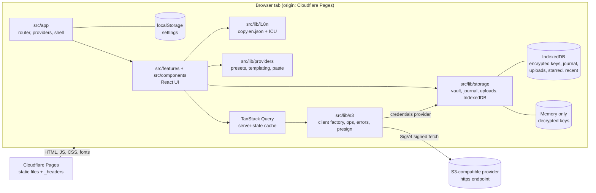

# Coffer technical specification

- **Purpose:** Define how Coffer is built: architecture, stack, data, S3 behavior, security, styling, accessibility, performance, testing and deployment.
- **Status:** Draft
- **Last updated:** 2026-11-21
- **Source files:** [`design/HANDOFF.md`](../design/HANDOFF.md), [`design/types.ts`](../design/types.ts), [`design/providers.json`](../design/providers.json), [`design/SECURITY-DESIGN.md`](../design/SECURITY-DESIGN.md), [`design/tokens.css`](../design/tokens.css), [`design/tailwind.css`](../design/tailwind.css), [`design/components.md`](../design/components.md), [`design/button-states.md`](../design/button-states.md), [`design/accessibility.md`](../design/accessibility.md), [`design/ux-patterns.md`](../design/ux-patterns.md)
- **Related:** [product-spec.md](product-spec.md) (FR/NFR), [product-brief.md](product-brief.md), [adr/](adr/), [open-questions.md](open-questions.md)

**Precedence.** Where `design/` files conflict, the newer seven (tokens, components, button-states, accessibility, HANDOFF) win on colors, button states, the elevated scope and the component list. Every conflict is logged in [open-questions.md](open-questions.md#design-conflicts-log). No code exists yet; commands and paths below are the target shape.

---

## 1. Architecture overview

Coffer is a single-page static app. The browser signs S3 requests with credentials the person entered and sends them straight to the provider. There is no Coffer server ([ADR-001](adr/ADR-001-no-backend.md)).



### Layers and import rules

Imports point down only. Violations fail lint.

| Layer | Path | May import | Must not import |
|---|---|---|---|
| App shell | `src/app/` | everything below | n/a |
| Features | `src/features/<area>/` | `components`, `lib/*`, other features only through their `index.ts` | `src/app` |
| Components | `src/components/` | `lib/i18n` (types only), `styles` | `features`, `lib/s3`, `lib/storage` |
| Domain libraries | `src/lib/s3`, `src/lib/storage`, `src/lib/providers`, `src/lib/i18n` | each other only as listed in [`src/AGENTS.md`](../src/AGENTS.md) | React, JSX, DOM UI, `components`, `features` |

### Data flow (UI → S3 client → provider)

1. A feature calls a hook (for example `useListing(prefix)`), which wraps a TanStack Query call.
2. The query function calls an operation in `src/lib/s3/ops` (for example `listFolder`), passing a `ConnectionContext` (profile, bucket).
3. The operation gets an `S3Client` from the client factory. The client's credentials provider reads the decrypted keys from the vault in memory. If the vault is locked, it throws `LockedError` and the UI shows Unlock.
4. The SDK signs the request (SigV4) and sends it with `fetch` to the provider. Errors are mapped to `AppError` (section 6.4) before they leave `lib/s3`.
5. Long operations (move, upload) write a journal or upload record in `lib/storage` first, report progress through a store the Transfer panel reads, and finish by invalidating the affected queries.

### Routing and state

- **Routing:** hash-based (`#/files/<encoded prefix>`, `#/trash`, `#/starred`, `#/settings/security`) with wouter's hash location (`wouter/use-hash-location`), the routes listed once as string literals in `src/app/routes.ts`. Keys and file names stay in the fragment, so they are never sent to the host or written to its logs (NFR-8). Preview and details are search params on the hash route.
- **Server state:** TanStack Query. Listing pages are `useInfiniteQuery` keyed by `[connectionId, bucket, prefix]`. Nothing sensitive is persisted by the query cache; it is memory only and cleared on lock.
- **Client state:** a small `zustand` store for session state (active connection, selection, transfer panel, toasts). Decrypted credentials are not in any store; they live only inside the vault module.
- **Persistent state:** IndexedDB for encrypted connections, journal, uploads, starred and recent; `localStorage` for settings ([ADR-007](adr/ADR-007-local-data-placement.md)).

### Demo mode (v1)

`lib/s3` exposes a `StorageBackend` interface (list, head, get-url, put, copy, delete). The real implementation uses the AWS SDK. Demo mode swaps in a read-only in-memory implementation over bundled sample files, so the UI code path is identical and no request leaves the page (FR-120, v1; MVP hides the entry point and ships only the interface).

---

## 2. Stack

| Choice | Why |
|---|---|
| **React + TypeScript (strict)** | Component model matches `components.md`; strict types make `design/types.ts` a real contract. |
| **Vite** | Fast static builds and chunk splitting; plain static output for Pages; no server runtime. |
| **Tailwind v4 + shadcn/ui (Radix)** | `design/tailwind.css` is already a Tailwind v4 `@theme inline` mapping; Radix gives accessible dialogs, menus, popovers and focus management that we restyle with tokens. |
| **TanStack Query** | Caching, retries and pagination for S3 listings without hand-written state machines. |
| **TanStack Virtual** | Lists with thousands of rows at 56 and 48 px (FileList is virtualized by design). |
| **lucide-react** | The design icons are lucide-compatible (stroke 2, 24 px grid). |
| **AWS SDK v3** (`@aws-sdk/client-s3`, `@aws-sdk/s3-request-presigner`) | Correct SigV4, XML parsing, retries and presigning. Modular imports keep the bundle smaller than SDK v2 or a hand-rolled signer ([ADR-002](adr/ADR-002-aws-sdk-v3.md)). Multipart uploads use a small own orchestrator over SDK commands; `@aws-sdk/lib-storage` is not used ([ADR-009](adr/ADR-009-own-multipart-orchestrator.md)). |
| **`idb`** | Small promise wrapper over IndexedDB with typed stores and versioned migrations. |
| **Web Crypto** | Native PBKDF2 and AES-GCM, with non-extractable derived keys; no crypto library to audit. |
| **pnpm** | Strict, fast, disk-efficient installs; lockfile with integrity hashes supports the dependency policy. |
| **Vitest + Testing Library, Playwright, a local S3 fixture (RustFS), axe** | See section 15. |

**Additions that the design implies but the brief did not list.** All approved by the owner ([C-16](open-questions.md#owner-confirmed-decisions), [C-17](open-questions.md#owner-confirmed-decisions)):

| Package | Reason | Decision |
|---|---|---|
| `intl-messageformat` | `copy.en.json` uses ICU plural syntax (`{count, plural, one {…} other {…}}`) | Adopted (small, formatjs) |
| `wouter` | Hash routing in about 2 KB gzip; replaces `@tanstack/react-router` (29 KB) ([C-50](open-questions.md#owner-confirmed-decisions)) | Adopted |
| `zustand` | Tiny session store, no provider boilerplate | Adopted |
| `fflate` | Streaming zip (decided: Q6) | Adopted, lazy chunk, v1 |
| `pdfjs-dist` | PDF preview; CSP has `object-src 'none'` so native embeds are blocked | Adopted, lazy chunk, bundled worker |
| `markdown-it` + `dompurify` | Markdown preview with `html: false` plus a sanitiser pass | Adopted, lazy chunk |
| `class-variance-authority`, `clsx`, `tailwind-merge`, `vaul` | shadcn defaults (variants, drawer for bottom sheets with a drag handle) | Adopted |

---

## 3. Data models

`src/lib/types.ts` is the **canonical contract**. It started as a copy of [`design/types.ts`](../design/types.ts), its origin, and is allowed to differ from it. There is no check that the two files match; every difference is listed below as T-n, and `design/types.ts` is never edited. Related conflicts are in [open-questions.md](open-questions.md#design-conflicts-log).

| # | Change | Why |
|---|---|---|
| T-1 | Never persist `credentials: { storage: "memory" }`. Persisted profiles use `StoredConnectionProfile = Omit<ConnectionProfile,"credentials"> & { credentials: EncryptedCredentials }`. Memory credentials live only in the vault module. | The union lets a plaintext profile be serialized by mistake. |
| T-2 | Add `v: 1` to the encrypted credentials object. | Migrations of the format. |
| T-3 | Extend `OperationJournalEntry` with `phase`, `cursor`, `failures`, `undoOf` (section 8). | Resume needs more than `total/done`. |
| T-4 | `ConnectionProfile.sessionTokenExpiresAt` is filled from the JWT `exp`, `AWS_CREDENTIAL_EXPIRATION` or a `Token expires at` field ([C-12](open-questions.md#owner-confirmed-decisions)). When it is absent and a session token is present, share links are capped at 1 hour. | Share limits for tokens without known expiry. |
| T-5 | Add `AppError` (code, retryable, status, hint, request id; never the SDK message). **Applied in M2a** (`src/lib/s3/errors.ts`). | Errors must be secret-free by construction. |
| T-6 | Document `Settings.uploadConcurrency` as parallel parts (copy `beh.parts`), not parallel files. | Name versus label mismatch. |
| T-8 | Add `"interrupted"` to `UploadStatus` (MVP). `needsFile` is used only from v1, when resume exists. | MVP aborts uploads on reload instead of resuming ([C-43](open-questions.md#owner-confirmed-decisions)). |
| T-7 | **Applied in M2a.** Add `ConnectionProfile.prefix?: string` (empty or ending in `/`): the connection root and start folder ([D-19](open-questions.md#decisions-made-on-the-owners-behalf)). | Prefix-scoped keys; test file and Trash live under it. |
| T-9 | **Applied in M2a.** Add `"localNetworkDenied"` to `TestFailure`: a loopback or private endpoint, and the browser has not allowed local network access ([C-54](open-questions.md#owner-confirmed-decisions)). | A denied permission and a stopped server look the same to `fetch`. |
| T-10 | **Applied in M2b.** Add `ConnectionSummary = Omit<ConnectionProfile, "credentials">`, the only form of a connection that React state, stores and props may hold. | Keys stay inside `lib/storage/vault` ([src/AGENTS.md](../src/AGENTS.md)). |
| T-11 | **Applied in M6a.** Add `JournalEntry` (the journal's own fields: `phase`, `cursor`, `failures`, `undoOf`) and `endpoint` on it, so a later session can match an entry to a connection without the old connection id ([D-41](open-questions.md#decisions-made-on-the-owners-behalf)). | Technical spec section 8 defines the fields; a memory-only connection has a new id each session. |

---

## 4. Provider preset engine

[`design/providers.json`](../design/providers.json) is loaded at build time, validated against `ProvidersFile` (JSON Schema generated from `types.ts` plus cross-checks below), and drives the whole connection form. Adding a provider is a data change ([`src/lib/providers/AGENTS.md`](../src/lib/providers/AGENTS.md) has the checklist).

**Build-time validation (fails the build):**
- every `{placeholder}` in `endpointTemplate` and `endpointTemplateByField` is a field `id` or `region`;
- `region.field`, `showWhen.field`, `roleWhen.field` name existing fields;
- `endpointPattern` and `expectedHostPattern` compile as regular expressions; named groups are field ids;
- each preset has exactly one field for each of `accessKeyId` and `secretAccessKey` role, or a `role` mapping (Supabase);
- `popularOrder` is unique among `popular: true` presets; `group` exists in `groups`.

**Advanced fields.** Presets with `sessionToken: true` and no token field get optional `Session token` (`role: "sessionToken"`) and `Token expires at` fields under Advanced ([C-13](open-questions.md#owner-confirmed-decisions)). Every preset gets an optional `Start in folder` field that sets `ConnectionProfile.prefix`, the connection root: all keys the UI shows and builds are relative to it, the breadcrumb root is the bucket or prefix and cannot go above it, and listing, search, usage, Trash and the connection test run under it.

**Form rendering.** Fields render in order from `ProviderField`: `control` picks the input (`text`, `password`, `select`, `combobox`, `segmented`); `label` is the provider's term and `generic` a caption; `validation` (`pattern`, `length`, `prefix`) runs on blur and on submit with the provider `message`. `showWhen` hides a field and drops its value from validation. `role` and `roleWhen` map fields to credentials: Supabase in session mode uses `projectRef` as the access key ID, `publishableKey` as the secret and `sessionToken` as the token.

**Endpoint templating.** `endpoint = template.replace(/\{(\w+)\}/g, field values)`; `endpointTemplateByField` overrides the template by a field's value (R2 `jurisdiction`: `eu`, `fedramp`; `default` uses the base template). Values are validated and URL-encoded as host labels (`[a-z0-9-]`); the result must parse with `new URL`, be `https:` (or `http:` only for `localhost` and `127.0.0.1`), and have no credentials, query or fragment. Presets without a template (MinIO, IDrive e2, custom) use an endpoint field.

**Region rules** (`RegionSpec.rule`):

| Rule | Behavior |
|---|---|
| `required` | Region field is required; signing region = value (AWS S3). |
| `fixed` | Region is `value` and no field is shown (R2 `auto`, GCS, Tigris, DO). |
| `equals` | Region equals the named field's value (B2, Wasabi, Scaleway, OSS, COS). |
| `custom` | A region field is shown with `default`. |
| `optional` | May be empty; `default` is used (Storj). |
| `fromEndpoint` | Parsed from the endpoint host (IDrive e2). If it cannot be parsed, the region field appears. |

`signingOnly` regions are never shown as a "where is my bucket" value.

**Addressing.** `forcePathStyle` is `true` for `path`, `false` for `virtual`. For `auto`: path-style when the host is an IP, `localhost` or has a port, or the bucket name contains a dot (wildcard TLS would fail); otherwise virtual-hosted. `addressingLocked` hides the choice. If a bucket-not-found error occurs on `auto`, the UI suggests Path (`form.addr.hint`) and the retry uses it. Virtual-hosted needs the CORS rule on the bucket host, which providers handle per bucket; path-style uses the endpoint host.

**Checksums.** Every client sets `requestChecksumCalculation: "WHEN_REQUIRED"` and `responseChecksumValidation: "WHEN_REQUIRED"` (all 21 presets use `checksumMode: "when_required"`). `when_supported` is accepted by the schema but unused today.

**Paste detection** (`parsePaste(text, preset)`): normalizes line endings, strips `export `, quotes and whitespace, then tries in order: (1) `KEY=VALUE` lines against `pasteHints.envVars` plus `AWS_CREDENTIAL_EXPIRATION` (read for every preset with `sessionToken: true`; ISO 8601; unparseable or past values are ignored) which fills `sessionTokenExpiresAt` (`AWS_ENDPOINT_URL_S3` wins over `AWS_ENDPOINT_URL`; `AWS_REGION` wins over `AWS_DEFAULT_REGION`); (2) an rclone `[name]` block with `key = value` lines mapped by `rcloneKeys`; (3) a bare endpoint matched case-insensitively against `endpointPattern`, filling named groups and `endpointPatternDefaults` for unmatched optional groups. Result: `{ fields: Record<id,string>, detected: id[] }`. The raw text is never logged or stored and the textarea is cleared after fill (FR-4).

**`expectedHostPattern`.** On continue, the resolved endpoint host is tested against it; a mismatch shows `form.endpointHostWarn` before any request. It is a warning, not a block. Presets with `null` skip it.

**Provider strings.** `helpSteps`, `scopedKeyAdvice`, `label`, `placeholder`, `message` and badge labels are provider content stored in `providers.json`, not in `copy.en.json`. They are the only UI text outside the copy file ([C-15](open-questions.md#owner-confirmed-decisions)). Missing keys live in `src/lib/i18n/copy.additions.en.json`, merged over `copy.en.json`; an addition may override a design key, and the build and CI fail when code uses a key that does not exist in the merged copy.

---

## 5. Connection test algorithm

Runs in `src/lib/s3/connection-test.ts` and returns `ConnectionTestResult` while emitting step updates for the progress list (`aria-live="polite"`). Test keys use the name `.coffer-test-<random 16 hex>.txt` under the connection's start folder when one is set, otherwise in the bucket root ([C-37](open-questions.md#owner-confirmed-decisions)); the name has 64 random bits, so it cannot realistically collide with an existing key and no extra request checks for one.

**Step 0: pre-flight (no request).** Validate the endpoint. If the page is `https:` and the endpoint is `http:` and not localhost, fail with `mixedContent` (message `ob.fail.net.*`).

**Local network access (C-54, D-29).** Before step 1, when the endpoint is loopback or a private address and the page's own address is less private, the screen reads the `loopback-network` or `local-network` permission (feature-detected, in try/catch). `prompt` shows the pre-prompt (`ob.localNetwork.*`) and waits for `Continue`; `denied` shows the remediation (`ob.fail.localNetwork.*`); `granted` and `unsupported` run. If step 1 then fails while access is still not granted, the failure is `localNetworkDenied`. The spike found that private-IP http stays blocked by the CSP, so only loopback http is allowed (D-29, [OQ-36](open-questions.md#oq-36-http-to-private-ip-endpoints)).

**Step 1: Reach endpoint.** `fetch(endpoint, { method: "HEAD", mode: "no-cors", cache: "no-store" })` with a 10 s timeout. A `no-cors` request resolves with an opaque response when any HTTP server answers (even 403), and rejects only on DNS, TLS, connection or mixed-content failure. Resolve = `pass`; reject = `fail` with `failure: "network"`. This is how a CORS block is told apart from "unreachable": CORS blocks reject the credentialed `cors` request but not the `no-cors` probe.

**Step 2: Check CORS.** Send a real signed `ListObjectsV2` (`MaxKeys: 1`) with the SDK. SDK requests add `x-amz-*` and `amz-sdk-*` headers, so the browser sends a preflight. Outcomes:
- fulfilled, or rejected with an S3 service error (the SDK parsed an HTTP response, so headers were readable) → CORS `pass`;
- rejected with a `TypeError` ("Failed to fetch") while step 1 passed → `fail`, `failure: "cors"` (CORS missing, wrong origin or method, a disallowed header, or an error response without CORS headers).
The page cannot see why; the helper screen lists the likely causes. When `list` below succeeds, this step passes with the same request (one call serves both steps; the UI still shows two rows).

**Step 3: List objects.** From the same call: interpret service errors:

| Error (`name`) | `failure` | Hint |
|---|---|---|
| `AccessDenied` | `accessDenied` | none |
| `SignatureDoesNotMatch`, `InvalidAccessKeyId` | `signatureDoesNotMatch` | `clockOffsetMinutes` if known |
| `RequestTimeTooSkewed` | `signatureDoesNotMatch` | offset from `<ServerTime>`/`<RequestTime>` in the body, or SDK `systemClockOffset` |
| `AuthorizationHeaderMalformed`, `PermanentRedirect`, `IllegalLocationConstraintException`, HTTP 301 | `wrongRegion` | `suggestedRegion` from `<Region>` in the body or `x-amz-bucket-region` |
| `NoSuchBucket` | `noSuchBucket` | none |
| other | `unknown` | none |

If no bucket was given, call `ListBuckets` instead; a 403 means "key cannot list buckets" and the test continues with manual bucket entry after the bucket is typed.

**Clock skew.** The device clock signs requests. The test records the SDK's computed clock offset after the first service response. The CORS rule written by the helper exposes `Date` so the offset can be read from headers; otherwise it comes from the error body. A skew over 5 minutes is reported in minutes (`ob.fail.sig.why`). The presigner uses the learned offset when signing links (section 10).

**Step 4: Write a test file.** `PutObject` of a 16-byte text body to the test key. `AccessDenied` here, with list passed, goes to the read-only branch.

**Step 5: Read it back.** `GetObject` of the test key; compare the body. On failure: `accessDenied` or `unknown`.

**Step 6: Clean up.** `DeleteObject`. Failure with `AccessDenied` → outcome `failed` (the app needs delete for rename, move and trash; [C-20](open-questions.md#owner-confirmed-decisions)).

**Read-only outcome.** If steps 1 to 3 pass and step 4 fails with `AccessDenied`: steps 5 and 6 become `skipped`, and a read probe runs instead: `GetObject` with `Range: bytes=0-0` on the first listed object. If it succeeds (or the bucket is empty, see [C-21](open-questions.md#owner-confirmed-decisions)), outcome = `readOnly` and `ReadOnlyOffer` shows. If the probe fails, outcome = `failed` with `accessDenied`.

**Mapping to UI.** `failure` selects the copy group: `cors` → `ob.cors.*` (`O42_CorsFail`); `mixedContent` and `network` → `ob.fail.net.*`; `signatureDoesNotMatch` → `ob.fail.sig.*`; `wrongRegion` and `noSuchBucket` → `ob.fail.bucket.*`; `accessDenied` → `ob.fail.denied.*`. `unknown` shows a generic message with a code and never raw error text.

**Timeouts and retries.** 10 s for reach, 30 s per signed call. No automatic retry in the test except one retry of step 1 on a timeout. The SDK retry count for normal operations is 3.

**CORS rule written by the helper** (origin from `window.location.origin`, never `*`):

```json
[
  {
    "AllowedOrigins": ["<origin>"],
    "AllowedMethods": ["GET", "PUT", "POST", "DELETE", "HEAD"],
    "AllowedHeaders": ["*"],
    "ExposeHeaders": ["ETag", "Date", "x-amz-request-id", "x-amz-bucket-region", "Content-Length", "Content-Range", "Accept-Ranges"],
    "MaxAgeSeconds": 3600
  }
]
```

`ETag` must be exposed or multipart uploads cannot collect part ETags. `AllowedHeaders: ["*"]` is the practical choice for SDK headers; it is safe because the origin is pinned. The XML tab renders the same rule as `<CORSConfiguration>`. Each provider's `helpSteps` say where to paste it.

---

## 6. S3 operations mapping

### 6.1 Client factory

`createClient(profile, vault)` in `src/lib/s3/client.ts`:

```ts
new S3Client({
  endpoint: profile.endpoint,
  region: profile.region,
  forcePathStyle: resolveAddressing(profile),
  credentials: () => vault.credentialsFor(profile.id), // throws LockedError when locked
  requestChecksumCalculation: "WHEN_REQUIRED",
  responseChecksumValidation: "WHEN_REQUIRED",
  maxAttempts: 3,
  requestHandler: new FetchHttpHandler({ requestTimeout: 30_000 }),
});
```

One client per connection, destroyed on lock or connection removal. No logging middleware that could print requests.

### 6.2 UI action to S3 calls

| UI action | S3 calls | Notes |
|---|---|---|
| Open folder | `ListObjectsV2` `Prefix`, `Delimiter: "/"`, `MaxKeys: 1000`, `EncodingType: "url"`, `ContinuationToken` | Folders from `CommonPrefixes`; a key equal to the prefix (placeholder) is skipped; keys and prefixes are URL-decoded by us. Stop at 2,000 items; "Load all" continues to 100,000 keys. |
| Refresh | same, from page 1 | Query invalidation. |
| Search | none (MVP) | Client-side filter of loaded items in the current folder (FR-23). v1 "Search all of {bucket}": `ListObjectsV2`, no delimiter, paged, name filter, cap 100,000 keys, cancellable. |
| Details | none; `HeadObject` only if content type missing | |
| Preview, download | none (presigned `GET`) or `GetObject` with `Range` | Section 6.5. |
| New folder | `PutObject` key `prefix/name/`, empty body, `ContentType: application/x-directory` | Placeholder object ([C-18](open-questions.md#owner-confirmed-decisions)). |
| Upload | `PutObject`, or `CreateMultipartUpload` + `UploadPart` + `CompleteMultipartUpload` (`AbortMultipartUpload` on cancel or error) | Section 7. |
| Rename / Make a copy / Move (object) | `CopyObject` (`CopySource` URL-encoded, `MetadataDirective: "COPY"`) → `HeadObject` on target → `DeleteObject` source (not for copy) | Verify rules in section 8. |
| Copy above 5 GB | `CreateMultipartUpload` on target → `UploadPartCopy` per range (`CopySourceRange: bytes=a-b`, parts of 256 MiB to 1 GiB) → `CompleteMultipartUpload` | Max 10,000 parts; the target keeps metadata by sending the source's `ContentType`, `CacheControl`, `ContentDisposition`, `ContentEncoding`, `ContentLanguage`, `Metadata` from a `HeadObject`. |
| Folder rename / move / trash / restore | `ListObjectsV2` (no delimiter) under the prefix, then per object as above, journaled | Folder placeholder is moved too. |
| Move to trash | move `key` → `{root}.coffer-trash/{batch}/{key}` where `batch` = `YYYYMMDDTHHMMSSZ-xxxxxx` (UTC, six random base-36 characters), generated once per operation | [ADR-004](adr/ADR-004-trash-as-prefix.md). |
| Restore | strip `{root}.coffer-trash/{batch}/` and move the object back to `{root}{key}` | Conflict dialog if the original key now exists. One prefix entry when a whole batch comes back with no clash; otherwise one entry per object (D-44). |
| Delete forever | `DeleteObjects` (`Quiet: true`, up to 1,000 keys per request) | Fallback to single `DeleteObject` calls if the provider rejects `DeleteObjects` (`MissingContentMD5`, `NotImplemented`); see compatibility matrix. |
| Trash view | `ListObjectsV2` `Prefix: "{root}.coffer-trash/"`, no delimiter, flattened across batches; keys not matching `{root}.coffer-trash/{batch}/...` are dropped | Deletion time and original path come from the batch prefix. |
| Empty trash | `ListObjectsV2` `Prefix: "{root}.coffer-trash/"` → `DeleteObjects` batches of up to 1,000, then one `DeleteObject` per key if the provider rejects the batch call; only keys in the batch format are deleted, others under the prefix are left alone | Typed count. Not journaled: a delete is safe to repeat and what is left stays in Trash (D-44). |
| Storage usage | `ListObjectsV2`, no delimiter, under the root, paged, cancellable | Sums by top-level prefix; shows requests made and an estimate of one request per 1,000 objects. |
| Download folder zip (v1) | `ListObjectsV2` → ranged `GetObject` per file → `fflate` | Streams to disk where supported. |
| Share link | none (local presign) | Section 10. |
| Connection test | section 5 | |

### 6.3 Listing details

- S3 returns keys in UTF-8 binary order; the UI sorts folders first, then by the chosen key using `Intl.Collator` (numeric, case-insensitive) for names.
- `LastModified` and `Size` sort needs all items; until loaded, the UI says so.
- Keys are limited to 1,024 bytes; the UI rejects longer ones. Characters that XML 1.0 cannot carry are why `EncodingType: "url"` is requested; if a provider rejects that parameter (see matrix) the client retries once without it.
- The trash prefix (`{root}.coffer-trash/`) is filtered from Files, search and Storage-by-folder, always.

### 6.4 Error mapping

All `lib/s3` functions throw `AppError { code, retryable, status?, hint? }` and never pass SDK errors upward. Codes: `locked`, `cors`, `network`, `mixedContent`, `accessDenied`, `signature`, `clockSkew`, `noSuchBucket`, `noSuchKey`, `wrongRegion`, `expiredToken`, `throttled` (`SlowDown`, 503; retryable with backoff), `conflict`, `quota`, `unsupported`, `aborted`, `unknown`. Messages shown to the person come from `copy.en.json` keys by code. `AppError` never stores request URLs, headers, signatures or SDK `message` text; it keeps only the S3 error `Code`, HTTP status, and a request ID when the provider returns one.

### 6.5 Presigned URLs for download and preview

Downloads, images, video and audio use presigned `GET` URLs so large files stream from the provider into the browser's own download manager or media element, with no CORS requirement and no data in app memory. Lifetimes: download 60 s, image 5 min, media 1 h; they are regenerated on error. The URLs include `response-content-disposition` (attachment with RFC 5987 filename for downloads, `inline` for previews). URLs are held in component state only, never logged, never put in the page URL, and `Referrer-Policy: no-referrer` stops them leaking through navigation. On a loopback `http` endpoint the CSP does not allow the presigned link in `img-src` or `media-src`, so the file is read through the signed API into a `blob:` URL instead (up to 200 MiB, [D-38](open-questions.md#decisions-made-on-the-owners-behalf)). Signed requests are sent with `cache: "no-store"`, so the browser's HTTP cache never rewrites a Range header. Text, code, Markdown, SVG and PDF previews need to read bytes, so they use `GetObject` with `Range` and therefore need the CORS rule (the CORS step already proved it).

---

## 7. Upload pipeline

| Parameter | Value |
|---|---|
| Single-request limit | below 16 MiB: one `PutObject` |
| Multipart threshold | 16 MiB and above |
| Part size | `max(8 MiB, ceil(size / 9000))` rounded up to the next MiB; never below 5 MiB except the last part |
| Max object | 5 TiB (rejected earlier); max parts 10,000 |
| Concurrency | `Settings.uploadConcurrency` (2, 4, 6, 8; default 4) parts in flight across all running uploads (one shared pool); at most 3 files active at once |
| Retry | per part, the SDK retry strategy (3 attempts, exponential backoff with jitter); `SlowDown` halves the pool for 30 s |
| Body | `Blob.slice` per part; never a `ReadableStream` (fetch streaming bodies need HTTP/2 and are not portable) |

**Upload orchestrator (MVP and v1).** `src/lib/s3/upload.ts` is a small orchestrator over SDK commands; `@aws-sdk/lib-storage` is not used ([ADR-009](adr/ADR-009-own-multipart-orchestrator.md)). Below 16 MiB it sends one `PutObject` with the `File` as body. From 16 MiB it runs: `CreateMultipartUpload` → persist `{ connectionId, bucket, key, uploadId, partSize }` through an injected `UploadStateStore` (implemented by `lib/storage`, so `lib/storage` never imports `lib/s3`) **before the first `UploadPart`** → one `UploadPart` per `Blob.slice` through the shared pool, each call given the task's `AbortSignal` → record each finished part number and `ETag` in the store → `CompleteMultipartUpload` with parts sorted by number → delete the record. On an error or a cancel it calls `AbortMultipartUpload` and deletes the record; if that abort itself fails the record is kept so the next load retries it. Progress is reported per finished part (`fetch` offers no upload progress). `ETag` must be exposed by the CORS rule, which the helper rule does.

**Reload during an upload (owner decision C-43).** On the next load, once the connection is unlocked, `src/app` reads the stored records and calls the orchestrator's `abortUpload` for each (`AbortMultipartUpload`), then marks the task `interrupted`; the transfer panel says the upload was interrupted and must be started again (`upl.interrupted.*`). If the vault is locked the aborts wait for unlock. A memory-only session does not survive a reload, so the stored `connectionId` is useless on the next load: each record also stores the provider `endpoint` and `bucket`, and any connection to the same endpoint and bucket aborts it ([D-36](open-questions.md#decisions-made-on-the-owners-behalf)). Each running upload holds the Web Lock `coffer-upload:<record id>` from before its record is written until it ends, and abort-on-load skips any record whose lock is held, because IndexedDB is shared across tabs and the upload may still be running in another one. Records for other buckets stay until a connection to them exists; the lifecycle-rule guidance below covers uploads that are never aborted. The `T13_Transfers` state "Upload paused when the page reloaded · Choose file" is not shown in MVP.

**Resume (v1, FR-42; replaces the abort-on-reload behavior).** The same orchestrator gains a resume path; no new upload code is needed because MVP already persists `uploadId`, `partSize` and the finished parts with their ETags (none of it is secret). On reload the task is `needsFile`; when the person picks a file whose `name`, `size` and `lastModified` match, the orchestrator calls `ListParts` to reconcile (the provider is the source of truth), uploads the missing parts and completes. If `ListParts` returns `NoSuchUpload`, it restarts from zero.

**Conflict handling.** Before a batch, collect target keys; check existence with `ListObjectsV2` on the target prefix (for batches over 50) or `HeadObject` per key (50 or fewer). Prompt once per batch (Replace, Keep both, Skip, Apply to all). `Keep both` appends ` (n)` before the extension using the first free number. `Replace` overwrites at completion (S3 publishes a multipart object only at `CompleteMultipartUpload`). Where the provider supports it, `If-None-Match: *` on the final request guards the "no conflict" and "Keep both" cases against races.

**Folder uploads** use `webkitRelativePath` (from `<input webkitdirectory>` or the drop's directory entries) to build keys. Empty directories are not uploaded unless the person creates them.

**`AbortIncompleteMultipartUpload` guidance.** Coffer aborts its own multipart uploads on cancel, failure and Discard, but a closed tab or crashed browser leaves parts that cost storage. Coffer cannot set lifecycle rules (non-goal), so About and the upload-paused message recommend adding an `AbortIncompleteMultipartUpload` rule (7 days) at the provider. A later release may list incomplete uploads with `ListMultipartUploads`.

**Limits per browser.** Mobile Safari may suspend background tabs; uploads continue only while the page is active and the panel says so when it detects `visibilitychange` to hidden with running tasks.

---

## 8. Operation journal

Stored in IndexedDB store `journal`. Extends `OperationJournalEntry` from `types.ts`:

```ts
interface JournalEntry extends OperationJournalEntry {
  phase: "planning" | "copying" | "deleting" | "finished";
  cursor?: string;                  // last source key fully processed (key order)
  failures?: { key: string; code: AppErrorCode }[];
  undoOf?: string;                  // id of the entry this one reverses
}
```

**Write-ahead rules** (NFR-9):

1. **Plan, then persist.** Before the first S3 request, write `{ status: "running", phase: "planning", source, target, total: 0 }`. After listing the source prefix, update `total` and set `phase: "copying"`.
2. **Per object: copy → verify → delete.** (a) `CopyObject` to the target key; (b) `HeadObject` on the target and compare `ContentLength` with the source size, and `ETag` when the source ETag has no `-` and no encryption makes ETags differ; (c) only then `DeleteObject` on the source. A failed verify never deletes.
3. **Persist progress** after each object for small operations and at most every 25 objects or 2 s for large ones; always before and after a retry boundary. `done` counts objects whose source is deleted. `cursor` is the last such source key.
4. **Never trust memory on resume.** Resume re-lists the source prefix from `cursor`, and for each remaining key: if the target exists and verifies, delete the source (the crash was between verify and delete); if not, copy afresh.
5. **Targets that already exist** (before the operation starts) go through the conflict dialog; during a resume an existing target is treated as a partial result only if it verifies against the source.
6. **Finish.** Set `phase: "finished"`, `status: "done"`. Done entries are kept 24 hours for Undo and then pruned.

**Resume, Review, Discard.** On app load (after unlock), entries with `status: "running"` whose operation lock is free become `interrupted`: a running operation holds the Web Lock `coffer-op:<entry id>`, so an entry that another tab is still running is left alone ([D-41](open-questions.md#decisions-made-on-the-owners-behalf); the same rule as uploads in D-36). Entries are matched to the connection by endpoint and bucket. The banner offers: **Resume** (rules 3 and 4), **Review** (a list of what is at the source and at the target, from live listings), **Discard** (set `status: "discarded"`; nothing is deleted; the person is told that some objects are at the target and some remain at the source).

**Undo.** For move, rename and trash the toast offers Undo while the entry exists. Undo creates a new entry with `undoOf` and the reversed source and target and runs the same rules. Copy and delete-forever have no Undo.

**Locking.** Locking does not pause an operation that is already running: it finishes with its credential lease (section 9). Queued operations wait and start after unlock. A trash entry stores its batch prefix (`target`) when it is created, so a resume reuses it.

**Concurrency.** Objects within one operation copy in parallel (up to 4) but deletes of a source key happen strictly after that key's verify. Two operations touching the same prefix are serialized. Each selected item is its own entry; the app runs the entries of a page one after another. A name that clashes at the destination is decided per selected item (files: Replace, Keep both, Skip; folders: Keep both, Merge), not per nested object. Keep both on a folder renames the moved folder to the first free `name (n)/`. Merge moves into the existing prefix: same keys are overwritten as the move reaches them and keys only the destination holds are never touched (D-42). Resume takes the lock `coffer-op:<id>` with `ifAvailable` before it does anything and re-reads the entry: if the lock is held the tab says the operation is running in another tab, and if the entry is no longer `interrupted` it says so; either way nothing runs twice (D-41).

---

## 9. Credentials and vault

Implemented in `src/lib/storage/vault.ts`. See [ADR-005](adr/ADR-005-encrypted-local-vault.md).

**Modes.** *Memory only* (`Not now`): keys exist only in the vault's in-memory map, gone on reload. *Saved*: keys are encrypted at rest in IndexedDB.

**Encryption.** Passphrase is NFKC-normalized and UTF-8 encoded. Key derivation: PBKDF2 with HMAC-SHA-256, **at least 600,000 iterations** (stored per record; raised on re-encrypt when the minimum increases), 16-byte random salt. The derived key is a **non-extractable** AES-GCM 256-bit `CryptoKey`. Each record encrypts the JSON `{ accessKeyId, secretAccessKey, sessionToken? }` with a fresh random 12-byte IV and additional authenticated data `coffer-v1|<profile id>`. Stored fields match `ConnectionProfile.credentials` (`cipher`, `kdf`, `iterations`, `salt`, `iv`, `data`, plus `v: 1`), base64url encoded.

**One passphrase, one derivation.** All saved profiles share one salt and iteration count, so unlock derives the key once (about 0.3 to 1 s on mobile) and caches the `CryptoKey` in memory. Adding a profile while unlocked reuses the salt. Changing the passphrase (v1) re-encrypts every record with a new salt and IVs, then drops the old key.

**Wrong passphrase.** AES-GCM authentication fails, shown as `ob.unlock.wrong`. The UI adds a growing delay after repeated failures. This protects usability, not against offline guessing; the 12-character minimum (saving is blocked below it) and the advisory hint at 16 or more characters are the real protection against that. No estimator library is used (a small local length and character-class check is enough).

**Memory handling.** Decrypted credentials are held in a closure-scoped `Map` in the vault module, never in React state, query cache, stores, URLs or devtools-visible objects. The S3 credentials provider reads them on demand. JavaScript strings cannot be reliably wiped, so the design limits their lifetime and spread rather than claiming erasure.

**Lock and auto-lock.** `lock()` clears the decrypted-credential map and the cached `CryptoKey`, destroys the connection's S3 clients, clears the query cache and routes to the Locked screen. Auto-lock fires after `Settings.autoLockMinutes` of no pointer, key or touch input (0 = never, discouraged and warned); manual Lock behaves the same. Running transfers do not count as activity ([C-27](open-questions.md#owner-confirmed-decisions)).

**Credential lease for running transfers.** When an upload or background operation starts, it takes a *lease*: a private copy of the credentials held in the closure of that task together with a dedicated S3 client. `lock()` leaves leases alone, so running transfers finish with in-memory credentials. A lease is released, and its copy and client dropped, when the task finishes, fails permanently or is cancelled. Queued tasks have no lease; acquiring one calls the vault, which throws `LockedError` while locked, so they wait and start after unlock. While locked, no UI path can start a new operation (actions are unreachable behind the Locked screen, and `lib/s3` entry points refuse without a lease or an unlocked vault). Closing the tab drops everything. While transfers run, the Locked screen shows the existing `Banner` (`ob.locked.transfers`) and a secondary `Button` `Stop transfers and lock` (`ob.locked.stop`); it cancels the transfers (aborting multipart uploads), releases their leases and completes the lock ([C-38](open-questions.md#owner-confirmed-decisions)).

**Reveal flow.** Showing a secret re-derives the key from a freshly typed passphrase (the cached key is not reused), decrypts the single record, shows the value in a component-local state for 15 seconds, then clears it. Copying shows `sec.clipboard`. Memory-only connections have no passphrase, so their secret is never re-displayed ([C-26](open-questions.md#owner-confirmed-decisions)).

**Forget this device** removes, in order: running transfers and their credential leases, pending timers and clients; the IndexedDB database `coffer` (`indexedDB.deleteDatabase`, after closing handles); every `localStorage` key with prefix `coffer:`; `sessionStorage`; Cache Storage and service-worker registrations if any exist; the in-memory vault and query cache. Then it reloads to Welcome. A test enumerates the local data inventory (section 11.5) and fails if a new storage location is added without being covered.

---

## 10. Share links

- Created locally with `getSignedUrl(client, new GetObjectCommand({ Bucket, Key, ResponseContentDisposition }), { expiresIn, signingDate })`. No request is made and nothing is logged or stored (the link is shown once in the dialog; the app keeps no link history).
- **Choices:** 15 min, 30 min, 1 hour, 1 day, 7 days (`ShareExpiry`; [C-11](open-questions.md#owner-confirmed-decisions)). **1 day is preselected** for normal keys; for session-token connections the longest allowed choice is preselected.
- **Limits** (`ShareLimits`): `maxSeconds = min(604800, secondsLeftOnToken − 60)`; `reason` is `presignLimit` when 7 days is the cap and `sessionToken` when the token is. Choices above `maxSeconds` are rendered disabled with `aria-disabled`. If `maxSeconds < 900`, no choice is available and the dialog says why. `secondsLeftOnToken` comes from `ConnectionProfile.sessionTokenExpiresAt` (JWT `exp`, `AWS_CREDENTIAL_EXPIRATION` or the `Token expires at` field; [C-12](open-questions.md#owner-confirmed-decisions)). A session token with no known expiry caps links at 1 hour (`reason: "sessionToken"`) and the dialog says so.
- **Clock.** The signing date is `Date.now() + learnedClockOffset` so a wrong device clock does not produce an immediately invalid link. The offset is the AWS SDK client's `config.systemClockOffset`, which the SDK updates from each response (D-46).
- **Messaging.** The dialog always shows `share.body` and `share.invalidate`; the UI must set `confirmedNotRevocable: true` explicitly before creating a link (typed as `true` in `ShareLinkOptions`). A link dies when its signing key is rotated or deleted, when it expires, or when the bucket policy denies the request.
- **Scope.** Single file only; folders and multi-selection are disabled (FR-60).

---

## 11. Security

### 11.1 Threat model summary

Trust boundaries and threats are in [`design/SECURITY-DESIGN.md`](../design/SECURITY-DESIGN.md) sections 1 to 3 and are not repeated here. Summary: **untrusted** are bucket file names and contents and share-link recipients; **partly trusted** are browser storage and the provider endpoint; **trusted** are the person and the app origin while headers hold. Out of scope: malware or extensions on the device, a compromised provider, a leaked passphrase.

### 11.2 `public/_headers`

Spec for the file Cloudflare Pages serves (from the design proposal, with cache rules added):

```
/*
  Content-Security-Policy: default-src 'none'; script-src 'self'; style-src 'self'; img-src 'self' data: blob: https:; media-src blob: https:; font-src 'self'; worker-src 'self' blob:; manifest-src 'self'; connect-src 'self' https: http://localhost:* http://127.0.0.1:*; frame-src 'none'; object-src 'none'; base-uri 'none'; form-action 'none'; frame-ancestors 'none'
  Referrer-Policy: no-referrer
  X-Content-Type-Options: nosniff
  Cross-Origin-Opener-Policy: same-origin
  Permissions-Policy: camera=(), microphone=(), geolocation=(), payment=()
  Strict-Transport-Security: max-age=63072000; includeSubDomains

/assets/*
  Cache-Control: public, max-age=31536000, immutable

/fonts/*
  Cache-Control: public, max-age=31536000, immutable

/
  Cache-Control: no-cache

/index.html
  Cache-Control: no-cache

/theme-init.js
  Cache-Control: no-cache
```

Notes:
- `connect-src https:` is required because the endpoint is chosen by the user; it is the only broad directive. `http://localhost:*` and `http://127.0.0.1:*` allow a local S3 server. Do **not** add `upgrade-insecure-requests` (it would break localhost `http`).
- `script-src 'self'` forbids inline scripts, so there is no inline theme script; `public/theme-init.js` is a small blocking file ([C-22](open-questions.md#owner-confirmed-decisions)). `style-src 'self'` forbids `<style>` tags and `style=""` attributes in HTML; React sets styles through the CSSOM, which is allowed. Radix, Vaul and TanStack Virtual set positions through React props, which works; this must be verified in a real browser (console shows no CSP violations) ([C-31](open-questions.md#owner-confirmed-decisions)).
- `frame-src 'none'`: the sandbox HTML preview is an `<iframe sandbox="" srcdoc>`, which `frame-src` does not govern ([D-39](open-questions.md#decisions-made-on-the-owners-behalf)), so nothing needs a frame source. A `blob:` frame would not render in Safari anyway. `worker-src 'self' blob:` is for the bundled pdf.js worker. `img-src https:` and `media-src https:` serve presigned previews.
- HSTS `preload` from the design proposal is omitted: preloading is a deliberate, hard-to-reverse choice for a domain the project controls ([C-32](open-questions.md#owner-confirmed-decisions)).
- A `<meta http-equiv>` CSP cannot replace `frame-ancestors`; the header is the source of truth. A CI check fetches the built `_headers`, parses it and asserts every directive above.
- Optional hardening (v1): `require-trusted-types-for 'script'` in Report-Only first.

### 11.3 Untrusted names and contents

| Surface | Rule |
|---|---|
| File and folder names | Rendered as React text nodes only. Never `dangerouslySetInnerHTML`, never interpolated into HTML strings, never used as an `href` without `new URL` validation. Truncation is CSS-only. |
| Keys in the URL | Only in the hash fragment, percent-encoded. |
| HTML files | Source view as text. "Render in sandbox": `<iframe sandbox="" srcdoc="…">` ([D-39](open-questions.md#decisions-made-on-the-owners-behalf)), no `allow-*` tokens, so no scripts, forms, popups or same-origin. The document inherits the page CSP and starts with a meta CSP of `default-src 'none'`, so remote images, styles and frames are never requested. |
| SVG | Only as `` with an explicit `image/svg+xml` blob type, size cap 2 MiB. Never inline, never `<object>`, `<embed>` or `<iframe>`. |
| Markdown | `markdown-it` with `html: false`, then DOMPurify with a strict allowlist (no `style`, no `iframe`, no `form`), remote images removed (no tracking requests), links `rel="noopener noreferrer" target="_blank"`, schemes `http`, `https`, `mailto` only. |
| Text and code | `textContent` into a `<pre>`; control characters are shown as visible symbols. |
| PDF | pdf.js with scripting disabled (`enableScripting: false`), no external links followed automatically. |
| Content types | The server's `Content-Type` is never trusted to decide rendering; the extension and a magic-byte sniff pick the `FileKind`. |
| Metadata | `x-amz-meta-*` values are text. |

### 11.4 No secrets in logs or errors

- The code base has no `console.*` in `src` outside a `logger` that accepts only a typed event code and a redacted context. A lint rule bans `console` elsewhere.
- Errors are `AppError` (section 6.4); SDK errors are caught at the `lib/s3` boundary.
- Secrets are masked in the UI (`••••••••c21`); the value is never in `aria-label`, `title`, `data-*` or the document title.
- Test fixtures use obviously fake keys; a unit test greps the built bundle and test logs for the AWS-key pattern.
- No error-reporting or analytics SDK is included.

### 11.5 Local data inventory

As in `SECURITY-DESIGN.md` section 5, with the placement decision from [ADR-007](adr/ADR-007-local-data-placement.md): connections, journal, uploads, starred and recent are IndexedDB stores in database `coffer`; settings are `localStorage` keys `coffer:settings` and `coffer:theme`. Every item has a removal path in Forget this device.

### 11.6 Dependency policy

- Direct dependencies are pinned to exact versions; `pnpm-lock.yaml` is committed; installs run with `--frozen-lockfile` in CI.
- `pnpm audit --prod` runs in CI and blocks on high or critical advisories.
- A new dependency needs a one-line justification in the PR (what it replaces, size, maintenance) and lands in an allowed layer. Runtime dependencies that touch bucket data or keys (Markdown, PDF, zip, crypto-adjacent) are reviewed for size and CVE history.
- No dependency may load code or fonts from a network location at runtime. No `postinstall` scripts from new dependencies without review (`pnpm` `onlyBuiltDependencies` allowlist).
- Prefer the platform (Web Crypto, `fetch`, `Intl`) over a library.
- A full security-audit pass is required before any release (the Cloudflare `security-audit` skill; see [`AGENTS.md`](../AGENTS.md)).

---

## 12. Styling system

- **Source of truth:** `design/tokens.json` (DTCG). A small generator in `scripts/tokens/` (written by Eng; [ADR-008](adr/ADR-008-token-generator.md)) turns it into `src/styles/tokens.css` and `src/styles/tailwind.css`, which are committed and never hand-edited. `pnpm tokens:build` regenerates them; `pnpm tokens:check` (run in CI) regenerates into a temporary directory and **fails if the output differs from the committed files**. The generator must first pass a golden test that reproduces `design/tokens.css` and `design/tailwind.css` (compared after whitespace normalization), so adopting it changes nothing visually ([C-28](open-questions.md#owner-confirmed-decisions)). `tokens.py` was not supplied and is not needed.
- **Entry:** `src/main.tsx` imports `./styles/tailwind.css` only (it imports `tokens.css` and Tailwind).
- **Tokens only.** No hex, rgb or px literals for color, spacing, radius, shadow, duration or font size in components; use Tailwind utilities mapped in `@theme inline` (`bg-surface`, `text-fg-muted`, `border-line`, `rounded-md`) or `var(--cf-*)`. A lint rule flags color literals and arbitrary values.
- **Layout by container.** `<div class="cf-root"><div class="cf-app">…</div></div>`: `.cf-root` is `container: cf-app / inline-size` and `.cf-app` is its direct child (a container cannot restyle itself). Use `@md:` (768), `@lg:` (1024), `@xl:` (1280), `@2xl:` (1440) variants; base styles are the 375 layout; `sm` is 360. At 1024 the container rule lowers the base font from 15 to 14 px ([ADR-003](adr/ADR-003-container-queries.md)).
- **Portals.** Radix portals must mount **inside** `.cf-root` (pass `container={rootRef.current}`), otherwise container-query rules and the layout width do not apply to overlays.
- **Theme.** `data-theme="light" | "dark"` is always set on `<html>`. `Settings.theme` = `system` follows `matchMedia('(prefers-color-scheme: dark)')` live; `light` and `dark` override. `public/theme-init.js` reads `coffer:theme` and sets `data-theme` before first paint. `tokens.css` defines dark only under `[data-theme="dark"]`, and the Tailwind `dark:` variant is `@custom-variant dark (&:where([data-theme="dark"], [data-theme="dark"] *))`.
- **Elevated and inverse scopes.** Dialog, Sheet, Popover, ContextMenu, NewMenu, FolderMenu, CommandPalette, the DetailsPanel overlay (below 1024) and the ConnectionSwitcher popover set `data-surface="elevated"` on their root and use `bg-elevated`. Toast sets `data-surface="inverse"`. The scopes re-declare hover, active, tonal and `--cf-btn-*` tokens; never recreate those values locally.
- **Button state rules** ([`design/button-states.md`](../design/button-states.md)): (1) every state step is at least 1.15:1 between fills and never opacity alone; (2) focus is a separate 2 px `border.focus` ring with 2 px offset (inverse layer: `inverse.accent`), never a fill change; (3) disabled is `text.disabled` on `bg.hover` with no hover or pressed; (4) hover only under `@media (hover: hover)`; (5) chips, cards and selected rows use the state-layer overlays; (6) selected rows use `bg.selected` plus a filled checkbox plus a 2 px accent edge; (7) dialog footer: one filled main action (primary or danger) plus one bordered secondary Cancel; destructive confirms use filled danger and stay disabled until the typed count matches; mobile sheets stack full width with the main action first at 48 px; (8) elevated layers use `bg.elevated`, never `gray.800` in dark.
- **Deviation.** Danger-tonal on the surface layer in light has fill-to-layer 1.14 against a 1.25 target; accepted as a hint-only fill because the label (7.46:1) and border (4.36:1) carry the meaning ([ADR-006](adr/ADR-006-danger-tonal-contrast-deviation.md)).
- **Fonts.** IBM Plex Sans (400, 500, 600) and Plex Mono (400) as self-hosted Latin-subset `woff2` in `public/fonts/`, declared with `@font-face` in the app CSS, `font-display: swap`, the two most used preloaded.
- **Motion.** 120 to 200 ms tokens; `prefers-reduced-motion` sets durations to 0 (tokens do this) and spinners and skeleton pulses stop.

### Components the design does not draw

The design lists 37 components. These primitives are implemented with shadcn/Radix and follow the same token, elevated-scope and state rules; none is a design blocker:

| Primitive | Basis | Rules |
|---|---|---|
| `Sheet` (bottom sheet, drag handle) and `Dialog` | Native `<dialog>` (`ModalSurface`), not Radix Dialog | Radix's scroll lock injects a `<style>` element, which `style-src 'self'` blocks; the native element gives focus trap, Escape and focus return without it. Below 768, `data-surface="elevated"`, safe-area padding, `dvh` max height ([D-24](open-questions.md#decisions-made-on-the-owners-behalf)) |
| `Popover` and menus | Radix, **non-modal only** (`modal={false}`) | From 768, elevated scope, `shadow.overlay`, portal inside `.cf-root`. Modal mode, `Select` and `ScrollArea` inject a style element the CSP blocks ([D-25](open-questions.md#decisions-made-on-the-owners-behalf)) |
| `Input`, `Textarea` | native | 48 px at 375 and 40 px from 768, visible label, `aria-describedby` for errors, 16 px text on mobile to avoid zoom |
| `Checkbox` | Radix Checkbox | Filled when checked, 44 px target on mobile |
| `Progress` | native `role="progressbar"` | Text value present, reduced-motion safe |
| `Tooltip` | Radix Tooltip | Hover and focus only, never the only label |
| `Skeleton` | CSS | Pulse stops under reduced motion |
| `Tabs` (CORS JSON/XML) | Radix Tabs | Arrow keys, `aria-selected` |
| `Switch`, `SegmentedControl` | Radix | Theme and addressing style |

---

## 13. Accessibility

Target **WCAG 2.2 AA** ([`design/accessibility.md`](../design/accessibility.md)); all rules there are requirements (NFR-5). How each is tested:

| Area | Rule | Test |
|---|---|---|
| Contrast | 4.5:1 text, 3:1 non-text; design numbers are **computed, not observed** | axe `color-contrast` in Playwright on every screen in both themes, plus a **manual real-browser contrast pass** (section 15.7) |
| Touch targets | 44 px at 375 | Playwright bounding-box assertion on interactive elements; 24 px minimum (WCAG 2.5.8) at all widths |
| Keyboard | every action has a path; list is one tab stop; dialogs trap focus, Esc closes, focus returns | Playwright keyboard flows for each FR with a keyboard path |
| Single-key shortcuts | only with list focus (WCAG 2.1.4) | Test that keys in inputs do nothing |
| Screen readers | landmarks, row names, `aria-selected`, live regions, `role=status` and `role=alert` | `jest-axe` on components, manual VoiceOver (iOS, macOS) and NVDA passes per release |
| Reflow and zoom | no horizontal scroll at 360; 200% zoom | Playwright at 360 and 320 px; zoom emulation |
| Motion | reduced motion drops durations to 0 | Test with `reducedMotion: "reduce"` |
| Forms | visible labels, errors linked, optional marked | Component tests |
| Color alone | status has icon and text; selection has check and edge | Visual review plus tests for the presence of text and icons |

---

## 14. Performance budgets

| Metric | Budget |
|---|---|
| JS transferred to render the first screen (Welcome, Unlock), cold load, gzip | ≤ 120 KB; the `index.html` entry alone ≤ 90 KB |
| S3 chunk (client-s3 modular imports, presigner, orchestrator; loaded at connect), gzip | ≤ 200 KB |
| Lazy chunks (pdf.js, fflate, Markdown, DOMPurify), each | loaded only on first use; pdf.js worker ≤ 400 KB gzip |
| Initial CSS, gzip | ≤ 25 KB |
| Fonts on first paint | ≤ 100 KB (two preloaded woff2 files) |
| Time to interactive, Welcome | ≤ 3.5 s on a mid-range phone profile (4× CPU slowdown, simulated Fast 4G) |
| LCP / INP / CLS | ≤ 2.5 s / ≤ 200 ms / ≤ 0.1 |
| First folder render after a successful list response | ≤ 100 ms for 2,000 items |
| List virtualization | always virtualized; overscan 8 rows; grid virtualized by row |
| Memory | 100,000 loaded keys must stay under about 150 MB of JS heap (store keys compactly) |

After M5b the JavaScript that `index.html` loads was **118.4 KiB gzip** against the 120 KiB budget; it carried TanStack Query, the shell, the transfer queue and the settings, none of which the first screen needs. The connected app is now one lazy chunk (`ConnectedApp`), and `pnpm size:check` reports **81.6 KiB** (react-dom is 77% of the per-module sizes). The 120 KiB row of the table is the JavaScript transferred to render the first screen on a cold load (D-43). `tests/e2e/first-load.spec.ts` measures it with Playwright (gzip of every script requested before the screen shows) for Welcome: **128.7 KiB** before the connect step went lazy, **99.0 KiB** after; the Unlock screen is added to that spec when the vault lands in M8. `pnpm size:check` keeps its own limit of 90 KiB on the entry that `index.html` loads (81.6 KiB today). The provider list, the form and the S3 client load when `Connect a bucket` is pressed and are prefetched with `requestIdleCallback` after Welcome renders; the provider count on Welcome is a build-time constant. `pnpm size:analyze` writes per-module sizes (`bundle-stats.json`) and prints the breakdown. pdf.js (147.8 KiB), its worker (387.6 KiB), markdown-it (39.8 KiB) and DOMPurify (11.1 KiB) are lazy chunks. Measured after M1 follow-ups ([C-50](open-questions.md#owner-confirmed-decisions), [C-51](open-questions.md#owner-confirmed-decisions), [C-52](open-questions.md#owner-confirmed-decisions)): the first route is **100.0 KB gzip** of JavaScript (and 8.2 KB of CSS), inside the 120 KB budget. Copy for features loads as separate chunks.

Enforcement: a bundle-size check (`size-limit` or Vite's report) in CI, Lighthouse CI against the preview deployment, and a Playwright performance test that renders a 5,000-item fixture and scrolls it.

---

## 15. Testing strategy

### 15.1 Layers

| Layer | Tool | Scope |
|---|---|---|
| Unit | Vitest | Pure logic: upload orchestrator with a fake client (part order, ETag sorting, abort on failure and cancel, record written before the first part), preset validation, templating, paste parser, key naming, conflict naming, share limits, error mapping, vault crypto round-trips, journal state machine, formatters |
| Component | Vitest + Testing Library + `jest-axe` | States, copy keys, ARIA, keyboard |
| Integration | Vitest (Node) against a **local S3 fixture (RustFS in Docker)** | Every operation in section 6.2, multipart, copy above the multipart limit (with a low configured limit), `DeleteObjects` batching, journal resume with injected faults |
| End to end | Playwright at **375, 768 and 1440** | Core jobs in Chromium; **WebKit (including an iPhone-sized mobile Safari profile) on every PR**; Firefox for smoke and layout |
| Accessibility | axe via Playwright, manual passes | Section 13 |
| Provider compatibility | Manual checklist per provider | Section 15.5 |

### 15.2 S3 fixture

`tests/integration/docker-compose.yml` runs RustFS (`rustfs/rustfs`, an S3-compatible server with an official, actively released image; the official MinIO images are no longer published) with fixed fake credentials. In CI the same image runs as a GitHub Actions service container. Integration tests run in Node, where CORS does not apply, and create their own buckets. `tests/integration/global-setup.ts` creates two users with per-user policies through RustFS's admin API: a read-only user (list and read) and a delete-denied user (write but no delete), which M2a needs for the read-only and clean-step cases. CORS is set **per bucket** with `PutBucketCors`, so browser tests can use one bucket with a rule and one without; no global CORS setting is involved. CORS failure cases in e2e can also use Playwright request interception (`page.route`) to return responses without CORS headers or abort the request, to cover `cors` versus `network`. `tests/integration/capabilities.test.ts` is the acceptance test for the fixture: if the server is ever swapped, it must pass there unchanged. Tests never use real cloud credentials; fixtures use fixed fake keys.

### 15.3 Fault injection

The S3 layer is wrapped by a test middleware that can fail or delay the Nth request. Tests cover: crash after copy before verify, after verify before delete, mid-multipart, `SlowDown`, expired token, offline.

### 15.4 E2E scenarios (minimum)

Connect (R2 preset against the S3 fixture with a custom endpoint), CORS-fail then fix, read-only offer, save with passphrase, lock and unlock, browse and search, upload with conflict, rename, move folder, trash and undo, restore, delete forever with typed count, share link with expiry limits, preview each type including hostile HTML, SVG and Markdown fixtures, Forget this device (storage dump is empty), theme switch.

### 15.5 Provider compatibility matrix

Manual, with a throwaway bucket and a scoped key per provider, run before each release for Popular presets and per release round for the rest. Not part of CI. Each cell is `pass`, `fail` with note, or `n/a`.

| Check | What it proves |
|---|---|
| Connect with the preset form and generated endpoint | Templates, regions, addressing |
| CORS rule from the helper applies and the test passes | `AllowedHeaders *`, `ExposeHeaders` support |
| List with `EncodingType=url`, delimiter and 1,000 pagination | Listing |
| Upload 1 KB, 20 MiB (multipart) and 200 MiB | Multipart and ETag exposure |
| Copy small and over the provider's single-copy limit | `CopyObject`, `UploadPartCopy` |
| `DeleteObjects` with 1,000 keys and the single-delete fallback | Checksum or MD5 behavior |
| Presigned download, preview (image, video, PDF) and 15-min and 7-day links | Presign limits |
| Session token (where applicable) | Token signing and expiry cap |
| Read-only key detection | `AccessDenied` shape on write |
| Wrong region and wrong bucket errors | Error mapping |
| Chrome stable: deployed HTTPS origin to `http://localhost:9000` and to a LAN address; check the pre-prompt, Allow, Block and a later change in site settings; confirm that a LAN `http` endpoint is rejected by the form | Local network access permission, `localNetworkDenied`, D-29 |
| Edge: the same as Chrome | Local network access permission |
| Safari (macOS and iOS): deployed HTTPS origin to `http://localhost:9000`; no prompt is expected; record what happens | No local network prompt |
| Firefox: the same as Safari | No local network prompt |
| Unicode, spaces and `#?%+` in keys | Encoding |

Presets with known quirks to record: Oracle OCI (browser CORS not supported), Alibaba OSS (virtual-hosted only), Tencent COS (bucket suffix), Supabase (session token mode), GCS (HMAC interoperability), IDrive e2 (per-account endpoint).

### 15.6 CI

On every PR: typecheck, lint (including token, string and layer rules), **copy-key check (every key used in code exists in the merged copy)**, **`pnpm tokens:check` (generated token CSS must equal the committed files)**, unit and component tests, integration against the S3 fixture, build, `_headers` check, bundle-size check, `dist/` allowlist check, e2e (Chromium and WebKit) with axe. The e2e tests run as six parallel jobs, one per browser and width (each with its own S3 fixture), with two workers each, a 30 s test timeout, one retry and a trace for every failed attempt; a final job merges the reports and writes the flaky and failed tests into the run summary, so a test that needed its retry is listed and never counted as a plain pass. Every job has a `timeout-minutes` (10, and 20 for e2e). Nightly or per release: Firefox e2e, Lighthouse, and a manual pass on a real iPhone (iOS Safari 16.4 or later is mandatory).

### 15.7 Verify contrast in a real browser (task)

Design contrast numbers are computed from tokens, not observed. Before release, a person opens the built app in Chrome, Safari and Firefox, in light and dark, and checks the pairs in `accessibility.md` and `button-states.md` for the surface, elevated and inverse layers with a color-picker or devtools contrast tool, plus the focus ring, disabled states and every button variant in rest, hover, active and focus. Results (pass or fail with screenshot) are saved in the release notes. Failures reopen a design question; they are not patched locally. Automated axe runs supplement this but do not replace it.

---

## 16. Deployment

- **Origin:** production uses the Cloudflare `pages.dev` address until a domain is chosen ([C-30](open-questions.md#owner-confirmed-decisions)); the design's `coffer.pages.dev` is a stand-in and the real subdomain is whatever Pages assigns. A custom domain is a later decision and triggers a review of HSTS.
- **Host:** Cloudflare Pages, static output from `pnpm build` (`dist/`), build image Node 22 LTS, no Functions, no environment secrets.
- **Preview deployments:** every PR gets a preview URL. Each distinct origin needs its own CORS entry; the helper always uses `window.location.origin`, so this works but preview URLs change per deployment. The preview banner (`X-Robots-Tag: noindex` is set by Pages) tells testers to use throwaway buckets.
- **Config:** none secret. Build-time values only: `VITE_APP_VERSION` (from `package.json`) and `VITE_COMMIT` (from `CF_PAGES_COMMIT_SHA`), shown in About. The CSP does not need a nonce because there are no inline scripts.
- **SPA routing:** hash routing needs no rewrite rules. There is no `404.html`, so Pages serves `index.html` for unknown paths.
- **Versioning:** semantic versioning in `package.json`, git tags `vX.Y.Z`, a short changelog per release, release notes include the compatibility matrix result and the real-browser contrast pass. MVP is `0.x`; `1.0.0` when the v1 scope in the product spec is complete.
- **Release gate:** headers verified on the preview, bundle budgets met, security audit done, compatibility matrix run, manual accessibility pass, real-iPhone Safari pass, `LICENSE` (MIT) present.
- **Rollback:** Pages keeps previous deployments; roll back by promoting the prior deployment.

---

## 17. Architecture decisions

| ADR | Decision |
|---|---|
| [ADR-001](adr/ADR-001-no-backend.md) | No backend, no database |
| [ADR-002](adr/ADR-002-aws-sdk-v3.md) | AWS SDK v3 with `WHEN_REQUIRED` checksums |
| [ADR-003](adr/ADR-003-container-queries.md) | Container queries for layout |
| [ADR-004](adr/ADR-004-trash-as-prefix.md) | Trash as the `.coffer-trash/` prefix |
| [ADR-005](adr/ADR-005-encrypted-local-vault.md) | Encrypted local vault (PBKDF2 to AES-GCM) |
| [ADR-006](adr/ADR-006-danger-tonal-contrast-deviation.md) | Danger-tonal light surface contrast deviation |
| [ADR-007](adr/ADR-007-local-data-placement.md) | Local data placement (IndexedDB versus localStorage) |
| [ADR-008](adr/ADR-008-token-generator.md) | In-repo DTCG to CSS token generator |
| [ADR-009](adr/ADR-009-own-multipart-orchestrator.md) | Own multipart upload orchestrator instead of `lib-storage` |

Owner decisions, open questions, decisions made on the owner's behalf and design conflicts are in [open-questions.md](open-questions.md).
